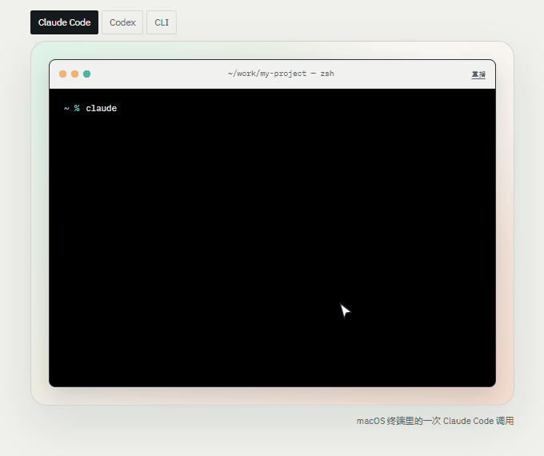

<p align="center">
  
</p>

<p align="center"><b>把 Bug 描述变成可复查的 Python/pytest 复现证据。</b></p>

<p align="center">
  <a href="#快速开始"><b>快速开始</b></a> |
  <a href="#使用"><b>使用</b></a> |
  <a href="#文档"><b>文档</b></a>
</p>

<p align="center">
  
  
  
  
  <a href="https://github.com/kyy-logs/ReproAgent/actions/workflows/test.yml"></a>
</p>

## ReproAgent 是什么？

ReproAgent 在本地读原始 Issue，写候选 pytest 测试，先证明它在问题版失败，再独立重跑一次，最后用修复版对照。只有三段结果相反，报告才会写 `DIFFERENTIAL_VALIDATED`。你得到的是 `report.md`、`trace.json`、`manifest.json` 和 `replay.py`，不是一段聊天记录。

生成测试很容易。难的是确认它真的调用到目标代码、断言打到目标行为，并且在问题版和修复版上给出相反结果。

<p align="center">
  
</p>
<p align="center"><sub>终端日志、报告画中画和脚本指针，均为本地页面里的真实 DOM 动画。</sub></p>

## 快速开始

### 安装

> 需要 Python 3.11+。安装、`setup --check`、启动器检查和目标项目检测都不调用模型。

#### Windows

在已有源码目录双击 `install.cmd`，或在 PowerShell 里：

```powershell
git clone https://github.com/kyy-logs/ReproAgent.git
cd ReproAgent
.\install.cmd -Force
```

安装器会查找 Python 3.11+（包括仓库 `.venv`），创建私有工具环境，安装依赖，写入 Claude Code / Codex 用户级入口，然后运行 `setup --check`。已有入口会先备份。完整参数见 [Windows 一键安装](docs/windows-install.md)。

#### macOS

```bash
git clone https://github.com/kyy-logs/ReproAgent.git
cd ReproAgent
python3 -m venv .venv
.venv/bin/python -m pip install -e .
.venv/bin/reproagent setup
```

macOS 目前通过命令行安装和接入；Windows 的一键安装器只适用于 Windows。页面里的安装卡片也提供 Windows / macOS 切换。

## 它能做什么

| 能力 | 内容 |
| --- | --- |
| **差分验证** | 问题版失败、同一候选在全新副本里独立重跑仍失败、兼容修复版通过；缺一段就停在更低的证据等级 |
| **真实执行** | 记录目标模块调用、断言结果、pytest 退出码和 Probe，不用字符串自比较或模型自报成功充数 |
| **本地优先** | 目标代码和测试在你的机器上运行；使用你的 Python、pytest、模型配置和凭据 |
| **宿主接入** | Claude Code 用 `/reproagent`，Codex 用 `$reproagent`，也可以直接走 CLI |
| **可交接** | 报告、trace、哈希清单和独立 `replay.py` 一起导出；接收方不需要 ReproAgent 或模型接口就能重跑 |

## 使用

### 在 Claude Code 里使用

安装器或 `reproagent setup` 会写入用户级 Skill。重启 Claude Code 会话后，在目标项目里：

```text
/reproagent check
/reproagent 帮我复现当前项目里的这个 Bug
/reproagent inspect repro-results/task-001
```

- `check` 检查工具解释器、CLI 和凭据来源，不调用模型。
- 复现命令可以接 Bug 描述，也可以接 task.json 路径。
- `inspect` 只读结果目录，不继续执行任务。

完整说明见 [Claude Code 使用说明](docs/claude-code.md)。

### 在 Codex 里使用

Codex 使用同一套入口和模型配置：

```text
$reproagent 帮我复现当前项目里的这个 Bug
```

接入方式、路径和旧版 layout 见 [AI 工具接入](docs/ai-tool-integration.md)。

### 用 CLI

```powershell
$env:DEEPSEEK_API_KEY = "your-key"
.\.venv\Scripts\reproagent.exe run --config examples/task.json --model-config examples/model.deepseek.json
.\.venv\Scripts\reproagent.exe inspect repro-results/task-001
```

`run` 会调用付费模型；安装、`setup --check`、启动器检查和 `inspect` 不调用模型。不要把密钥写进配置文件，用环境变量提供。macOS 把 `.\.venv\Scripts\reproagent.exe` 换成 `.venv/bin/reproagent`，其余参数相同。

可选差分对照：

```powershell
.\.venv\Scripts\reproagent.exe run --config examples/task.json `
  --model-config examples/model.deepseek.json `
  --fixed-repo C:\path\to\fixed-copy `
  --fixed-python C:\path\to\fixed-copy\.venv\Scripts\python.exe
```

修复版只在候选冻结后用于对照；修复源码、测试和补丁不进入探索上下文。

退出码：`DONE=0`；`BLOCKED`、`NEEDS_INFORMATION`、`EXHAUSTED=1`；配置错误 `2`；`FAILED=3`；`CANCELLED=130`。

## 一次运行会留下什么

| 文件 | 内容 |
| --- | --- |
| `report.md` | 结论、三次运行、失败摘要和审查入口；先读这个 |
| `trace.json` | 模型调用、工具步骤、输入输出和耗时 |
| `manifest.json` | 文件哈希与证据清单 |
| `replay.py` | 在全新副本里重跑同一候选，不依赖 ReproAgent |

成功包在 `artifacts/reproduction/`，trace 在 `observability/trace.json`；未确认任务输出到 `artifacts/diagnostic/`。

### 证据等级

| 等级 | 含义 |
| --- | --- |
| `DONE` | 流程结束，不证明复现 |
| `SINGLE_OBSERVATION` | 只发生了一次原版运行 |
| `REPEATED_OBSERVATION` | 同一候选在独立副本里重跑过 |
| `DIFFERENTIAL_VALIDATED` | 原版失败、独立重跑失败、兼容修复版通过 |

`DONE` 不是差分验证。模型打印 “reproduced”、pytest 退出码 1、捕获一个预期错误或 xfail，都不能单独建立成功。完整字段和报告模板见 [技术亮点与输出](docs/technical-highlights-and-output.md)。

成功包可以复制到任意目录，在另一份相同 Bug 版本的副本里重跑：

```powershell
python path/to/reproduction/replay.py `
  --repo path/to/fresh-buggy-copy `
  --python path/to/project-python `
  --output path/to/new-replay-output `
  --install
```

回归测试在 Bug 版本失败，因此复跑退出 1 是预期现象；核对新 Probe 的实际失败。

## 它怎么工作

```text
Issue → contract → candidate pytest → buggy → rerun → fixed → sealed
```

1. 读原始描述和代码事实。
2. 建立触发条件和观察点。
3. 写候选 pytest 测试。
4. 在问题版上执行。
5. 用全新副本独立重跑。
6. 用兼容修复版对照。
7. 导出报告、trace、manifest 和 replay。

每一步都留下可检查的记录；报告等级由最后三段决定。

## 适合 / 不适合

**适合**

- Python 和 pytest 项目，需要一个能复查的回归测试。
- 维护者、QA、AI coding agent 用户，想确认真实复现而不是看聊天结论。
- 需要把“问题版失败、修复版通过”固化成证据的团队。
- 希望本地执行、自己控制模型 provider 和凭据的团队。

**不适合**

- 非 Python、非 pytest 项目。
- 期待工具自动修改业务代码、直接给出最终修复。
- 期待保证所有 Bug 都能复现，或把单次成功当成整体复现率。
- 需要托管式云端执行、完全不用本地环境的产品。

目标项目的 Python、pytest 和业务依赖由目标项目提供。ReproAgent 不会给目标环境安装包、修改业务代码或启动缺失服务。

## 配置

复制 `examples/task.json`，按目标项目改：

| 字段 | 说明 |
| --- | --- |
| `repo` / `issue_file` / `output_dir` | 相对 task 配置文件所在目录解析；每次使用新的输出目录 |
| `language.python` | 目标项目解释器的绝对路径 |
| `language.target_modules` | 实际待观察模块，例如 `package.parser` |
| `language.source_roots` | 项目源码根，相对项目目录，例如 `["src", "."]` |
| `language.candidate_parent` | 能继承相关 conftest 的测试目录，例如 `tests/unit` |
| `language.pytest_args` | 支持 `-q/-v/-vv/-s/--disable-warnings/--tb=*`；不允许 Agent 覆盖 |
| `baseline_tests` | 可选，先观察已有测试；断言失败会记录，不直接判定环境不可用 |

模型配置使用兼容 Chat Completions 的 JSON 文本接口，填写 `base_url`、`model` 和 API key 的环境变量名。示例：

- `examples/model.deepseek.json`
- `examples/model.deepseek.non-thinking.json`
- `examples/model.json`

供应商不支持 `max_completion_tokens` 时，把 `output_limit_field` 改成 `max_tokens`。

## 文档

| 想了解什么 | 文档 |
| --- | --- |
| 安装、任务配置和 CLI | 本 README / [示例配置](examples/) |
| Windows 安装与目标项目检查 | [docs/windows-install.md](docs/windows-install.md) |
| Claude Code / Codex 接入 | [docs/ai-tool-integration.md](docs/ai-tool-integration.md) |
| Claude Code 调用方式 | [docs/claude-code.md](docs/claude-code.md) |
| report.md、证据等级和 replay | [docs/technical-highlights-and-output.md](docs/technical-highlights-and-output.md) |
| trace、工具调用和诊断 | [docs/observability.md](docs/observability.md) |
| 经验库 | [docs/experience.md](docs/experience.md) |
| SWT-Bench 数据与官方评测 | [docs/swt-bench.md](docs/swt-bench.md) |
| 文档总导航 | [docs/](docs/) |

## 项目状态

当前是本地 CLI MVP，只有一套基础设施：AgentScope。模型调用、受限文件工具、阶段内执行和消息历史由 SDK 提供；复现策略、业务编排、证据核验和独立交付仍由 ReproAgent 负责。

评测是小样本，不代表一般复现率：

- 官方 SWT-Bench harness 在 10 例未参与调试的新样本上判定 **RESOLVED 1/10**（`sphinx-doc__sphinx-11445`）；其中 3 例没有 verified 报告，整轮仍记为待判分。
- 历史修复环境样本的 20 例复测是单独的**非官方**记录，不能与官方 harness 分数混用。
- CI 离线矩阵覆盖 Windows / Ubuntu × 目标 Python 3.10–3.12 × pytest 7.4–9，当前 18/18 通过。

完整记录：[SWT-Bench](docs/swt-bench.md) · [历史评测记录](docs/evaluations/) · [问题与挑战记录](docs/reports/reproagent-问题与挑战记录.md)。单次成功不代表整体复现率，独立人类评审仍待进行。

## 开发

```powershell
python -m venv .venv
.\.venv\Scripts\python.exe -m pip install -e ".[dev]"
.\.venv\Scripts\python.exe -m pytest tests/unit tests/integration -q
.\.venv\Scripts\python.exe -m pip check
.\.venv\Scripts\python.exe -m pip wheel . --no-deps --no-build-isolation --wheel-dir dist
```

测试覆盖真实 pytest、进程清理、源码来源、独立导出和 wheel 安装；独立目标环境只装 pytest。首次打包测试会创建开发测试环境并安装 pytest，不修改用户目标环境。

架构说明见 [docs/agentscope.md](docs/agentscope.md)，评测样本说明见 [evals/README.md](evals/README.md)，当前设计与计划见 [docs/superpowers/](docs/superpowers/)。

## 安全与限制

- 文件副本隔离不是安全沙箱。目标代码、pytest 插件和生成的测试拥有当前用户的系统与网络权限；只在可信项目和可丢弃环境使用。
- 原始日志可能包含敏感值；模型片段和导出副本只脱敏已知 API key。发布前检查其他凭据。
- 暂不支持 xdist、浏览器、自动依赖修复、数据库重置、外部服务自动启动、resume 和多候选并行搜索。
- 语义核对依赖模型；证据引用和硬性检查降低误报，但不能替代人的审查。
- Windows 导出和独立 replay 有目录长度限制；目标 pytest 或依赖自身的长路径限制仍可能阻止启动。

维护者：设计与计划 [docs/superpowers/](docs/superpowers/) · 历史评测 [docs/evaluations/](docs/evaluations/)。
