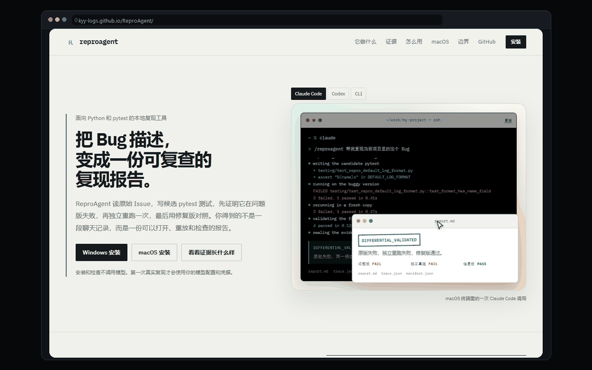

<p align="center">
  <a href="https://kyy-logs.github.io/ReproAgent/">
    
  </a>
</p>

<p align="center"><b>Evidence-first reproduction for Python/pytest bugs.</b></p>

<p align="center">
  <a href="README_zh.md"><b>中文</b></a> |
  <a href="https://kyy-logs.github.io/ReproAgent/"><b>Product page</b></a> |
  <a href="#quickstart"><b>Quickstart</b></a> |
  <a href="ROADMAP.md"><b>Roadmap</b></a>
</p>

<p align="center">
  
  
  
  
  <a href="https://github.com/kyy-logs/ReproAgent/actions/workflows/test.yml"></a>
</p>

## What is ReproAgent?

ReproAgent reads the original issue, writes a candidate pytest test, proves it fails on the buggy version, reruns the same candidate in a fresh copy, and finally checks it against a compatible fixed version. Only when those three runs disagree in the expected direction does the report say `DIFFERENTIAL_VALIDATED`. You get `report.md`, `trace.json`, `manifest.json` and `replay.py`, not a chat transcript.

Generating a test is easy. Proving that it calls the target code, asserts the target behavior, and produces opposite results on the buggy and fixed versions is the hard part.

<p align="center">
  <a href="https://kyy-logs.github.io/ReproAgent/">
    
  </a>
</p>
<p align="center"><sub>Whole-page preview in a browser window: hero, evidence, pipeline, install, boundaries and the final CTA.</sub></p>

## News

<!-- BEGIN NEWS -->
- **2026-10-25 · `FEAT`** — Windows one-click setup for Claude Code / Codex: finds or installs Python 3.11+, creates a private tool environment, writes user-level entries, runs setup checks, and adds a read-only target-project check. [Install guide](docs/windows-install.md)
- **2026-10-25 · `DOCS`** — New product page and user-facing READMEs (English / 中文). Product page source: [site/index.html](site/index.html).
- **2026-10-15 · `FEAT`** — Verifier feedback now carries the cited evidence text and structured evidence gaps, making failures easier to locate. [Output notes](docs/technical-highlights-and-output.md)
- **2026-10-13 · `FEAT`** — The experience library supports task-scoped catalog browsing and on-demand loading. [Experience library](docs/experience.md)
- **2026-10-10 · `FEAT`** — Local trace viewer with a step tree, timeline and tool-call inspection; nothing is uploaded. [Observability](docs/observability.md)
<!-- END NEWS -->

[Full changelog →](docs/NEWS.md)

## Quickstart

### Install

> Requires Python 3.11+. Install, `setup --check`, launcher checks and target-project checks do not call a model.

#### Windows

Run `install.cmd` from the source directory, or use PowerShell:

```powershell
git clone https://github.com/kyy-logs/ReproAgent.git
cd ReproAgent
.\install.cmd -Force
```

The installer looks for Python 3.11+ (including the repository `.venv`), creates a private tool environment, installs dependencies, writes Claude Code / Codex user-level entries, and runs `setup --check`. Existing entries are backed up first. See [Windows installer](docs/windows-install.md).

#### macOS

```bash
git clone https://github.com/kyy-logs/ReproAgent.git
cd ReproAgent
python3 -m venv .venv
.venv/bin/python -m pip install -e .
.venv/bin/reproagent setup
```

macOS currently uses the command-line installation path. The Windows one-click installer is Windows-only.

## What it proves

| Capability | What you get |
| --- | --- |
| **Differential validation** | Buggy version fails, the same candidate fails again in a fresh copy, and a compatible fixed version passes; missing a run lowers the evidence level |
| **Real execution** | Target-module calls, assertion results, pytest exit codes and Probe records; no string self-comparison or model self-report |
| **Local-first** | Target code and tests run on your machine with your Python, pytest, model configuration and credentials |
| **Host integration** | Claude Code uses `/reproagent`, Codex uses `$reproagent`; the CLI is also available directly |
| **Handoff** | `report.md`, trace, hash manifest and standalone `replay.py`; the receiver does not need ReproAgent or a model endpoint to rerun |

## Usage

### Claude Code

The installer or `reproagent setup` writes a user-level Skill. Restart the Claude Code session, then use it from the target project:

```text
/reproagent check
/reproagent reproduce the bug in this project
/reproagent inspect repro-results/task-001
```

- `check` verifies the tool interpreter, CLI and credential source without calling a model.
- The reproduction command accepts a bug description or a task.json path.
- `inspect` only reads a result directory and does not continue the task.

See [Claude Code guide](docs/claude-code.md).

### Codex

Codex uses the same entries and model configuration:

```text
$reproagent reproduce the bug in this project
```

See [AI tool integration](docs/ai-tool-integration.md) for paths and the legacy layout option.

### CLI

```powershell
$env:DEEPSEEK_API_KEY = "your-key"
.\.venv\Scripts\reproagent.exe run --config examples/task.json --model-config examples/model.deepseek.json
.\.venv\Scripts\reproagent.exe inspect repro-results/task-001
```

`run` calls the paid model. Install, `setup --check`, launcher checks and `inspect` do not. Do not put keys in a config file; use an environment variable. On macOS, replace `.\.venv\Scripts\reproagent.exe` with `.venv/bin/reproagent`.

Optional fixed-version comparison:

```powershell
.\.venv\Scripts\reproagent.exe run --config examples/task.json `
  --model-config examples/model.deepseek.json `
  --fixed-repo C:\path\to\fixed-copy `
  --fixed-python C:\path\to\fixed-copy\.venv\Scripts\python.exe
```

The fixed source is only used after the candidate is frozen; fixed code, tests and patches do not enter the exploration context.

Exit codes: `DONE=0`; `BLOCKED`, `NEEDS_INFORMATION` and `EXHAUSTED=1`; configuration error `2`; `FAILED=3`; `CANCELLED=130`.

## What you get

| File | Contents |
| --- | --- |
| `report.md` | Conclusion, the three runs, failure summary and review entry points; read this first |
| `trace.json` | Model calls, tool steps, inputs/outputs and timing |
| `manifest.json` | File hashes and evidence inventory |
| `replay.py` | Reruns the same candidate in a fresh copy without ReproAgent |

Successful packages live under `artifacts/reproduction/`; trace is written to `observability/trace.json`. Unconfirmed runs go to `artifacts/diagnostic/`.

### Evidence levels

| Level | Meaning |
| --- | --- |
| `DONE` | The flow finished; it does not prove reproduction |
| `SINGLE_OBSERVATION` | One original-version run happened |
| `REPEATED_OBSERVATION` | The same candidate was rerun in an independent copy |
| `DIFFERENTIAL_VALIDATED` | Original fails, independent rerun fails, and a compatible fixed version passes |

`DONE` is not differential validation. A model saying “reproduced”, pytest exit code 1, a captured expected error or an xfail cannot establish success on its own. See [technical highlights and output](docs/technical-highlights-and-output.md).

A successful package can be copied anywhere and replayed in another copy of the same buggy version:

```powershell
python path/to/reproduction/replay.py `
  --repo path/to/fresh-buggy-copy `
  --python path/to/project-python `
  --output path/to/new-replay-output `
  --install
```

The regression test is expected to fail on the buggy version, so exit code 1 is normal; verify the actual failure in the new Probe.

## How it works

```text
Issue → contract → candidate pytest → buggy → rerun → fixed → sealed
```

1. Read the original description and repository facts.
2. Build the trigger conditions and observable checks.
3. Write the candidate pytest test.
4. Run it against the buggy version.
5. Rerun it in a fresh copy.
6. Compare it against a compatible fixed version.
7. Export the report, trace, manifest and replay tool.

Every step leaves inspectable records; the evidence level is decided by the last three runs.

## Fit / not a fit

**Fits**

- Python and pytest projects that need a reviewable regression test.
- Maintainers, QA and AI coding-agent users who want real reproduction evidence instead of a chat conclusion.
- Teams that need to turn “buggy fails, fixed passes” into evidence.
- Teams that want local execution and control over model providers and credentials.

**Not a fit**

- Non-Python or non-pytest projects.
- Automatic business-code fixes or a final patch.
- A guarantee that every bug reproduces, or treating one success as an overall reproduction rate.
- Hosted cloud execution with no local environment.

The target project supplies its own Python, pytest and business dependencies. ReproAgent does not install packages into the target environment, modify business code or start missing services.

## Configuration

Copy `examples/task.json` and adjust it for the target project:

| Field | Meaning |
| --- | --- |
| `repo`, `issue_file`, `output_dir` | Resolved relative to the task config; use a fresh output directory each time |
| `language.python` | Absolute path to the target project interpreter |
| `language.target_modules` | Modules to observe, e.g. `package.parser` |
| `language.source_roots` | Source roots relative to the project, e.g. `["src", "."]` |
| `language.candidate_parent` | Test directory that inherits the relevant conftest, e.g. `tests/unit` |
| `language.pytest_args` | Supports `-q/-v/-vv/-s/--disable-warnings/--tb=*`; the Agent cannot override them |
| `baseline_tests` | Optional existing tests; assertion failures are recorded, not treated as an unusable environment |

Model configs use a Chat-Completions-compatible JSON text endpoint with `base_url`, `model` and an API-key environment variable. Examples:

- `examples/model.deepseek.json`
- `examples/model.deepseek.non-thinking.json`
- `examples/model.json`

If a provider does not support `max_completion_tokens`, set `output_limit_field` to `max_tokens`.

## Docs

Documentation is currently Chinese-first. The CLI, installer and product page are usable without reading it.

| Topic | Document |
| --- | --- |
| Product page (Chinese) | [kyy-logs.github.io/ReproAgent](https://kyy-logs.github.io/ReproAgent/) |
| Product page source | [site/index.html](site/index.html) |
| Install, task config and CLI | This README / [examples](examples/) |
| Windows install and target check | [docs/windows-install.md](docs/windows-install.md) |
| Claude Code / Codex integration | [docs/ai-tool-integration.md](docs/ai-tool-integration.md) |
| Claude Code usage | [docs/claude-code.md](docs/claude-code.md) |
| report.md, evidence levels and replay | [docs/technical-highlights-and-output.md](docs/technical-highlights-and-output.md) |
| Trace, tool calls and diagnostics | [docs/observability.md](docs/observability.md) |
| Experience library | [docs/experience.md](docs/experience.md) |
| SWT-Bench data and official evaluation | [docs/swt-bench.md](docs/swt-bench.md) |
| Documentation index | [docs/](docs/) |

The Chinese homepage is [README_zh.md](README_zh.md). The roadmap is [ROADMAP.md](ROADMAP.md).

## Project status

This is a local CLI MVP with a single runtime: AgentScope. The SDK provides model calls, restricted file tools, in-stage execution and message history; ReproAgent owns the reproduction strategy, orchestration, evidence verification and handoff.

Evaluation is small-sample and does not represent a general reproduction rate:

- The official SWT-Bench harness judged **RESOLVED 1/10** on ten previously unseen holdout cases (`sphinx-doc__sphinx-11445`). Three cases had no verified report, so the round remains pending.
- The historical 20-case repaired-environment rerun is a separate **non-official** record and must not be mixed with official harness scores.
- The offline CI matrix covers Windows / Ubuntu × target Python 3.10–3.12 × pytest 7.4–9; it is currently 18/18.

Full records: [SWT-Bench](docs/swt-bench.md) · [historical evaluations](docs/archive/evaluations/) · [issues and fixes](docs/reports/问题与修复索引.md). One success is not an overall reproduction rate, and independent human review is still pending.

## Development

```powershell
python -m venv .venv
.\.venv\Scripts\python.exe -m pip install -e ".[dev]"
.\.venv\Scripts\python.exe -m pytest tests/unit tests/integration -q
.\.venv\Scripts\python.exe -m pip check
.\.venv\Scripts\python.exe -m pip wheel . --no-deps --no-build-isolation --wheel-dir dist
```

Tests cover real pytest, process cleanup, source provenance, standalone export and wheel installation; the independent target environment only installs pytest. The first packaging test creates a development test environment and installs pytest without modifying the user's target environment.

See [AgentScope infrastructure](docs/agentscope.md), [evaluation notes](evals/README.md) and the [current designs and plans](docs/superpowers/README.md).

## Security and limitations

- A copied working directory is not a security sandbox. Target code, pytest plugins and generated tests run with the current user's system and network permissions; use trusted projects and disposable environments only.
- Raw logs may contain secrets. Model snippets and exported copies redact known API keys only; inspect other credentials before publishing.
- The current MVP does not support xdist, browsers, automatic dependency repair, database reset, external-service startup, resume or parallel candidate search.
- Semantic review uses a model. Evidence citations and hard checks reduce false positives but do not replace human review.
- Windows export and standalone replay have directory-length limits; target pytest or dependency path limits can still prevent startup.

Maintainers: [current designs and plans](docs/superpowers/README.md) · [historical archive](docs/archive/README.md).
